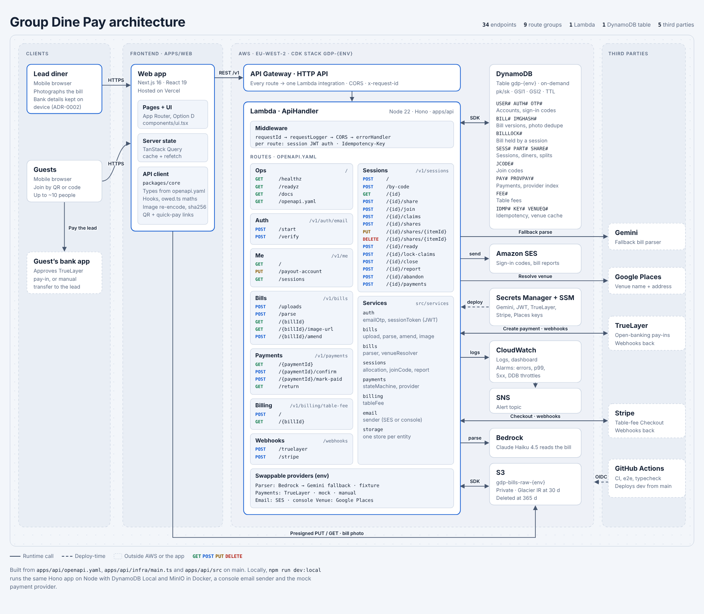
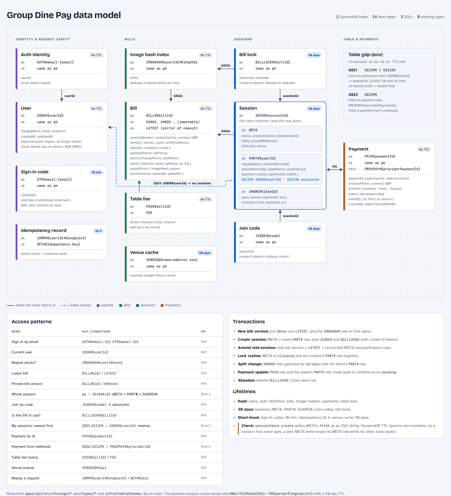

# Architecture

Two diagrams of the system as it is on `main`.

| Diagram | Shows |
| --- | --- |
| [System](system.html) | Clients, the web app, API Gateway, the Lambda with every endpoint, AWS services and third parties |
| [Data model](data-model.html) | The DynamoDB single table: every item type, its keys and TTL, both GSIs, access patterns and transactions |

The `.html` files are the real diagrams (light and dark theme, readable at any size). GitHub won't render them, so open them locally or use the PNG previews below.

## System



## Data model



## Updating

The pages are generated. Edit the script, not the HTML:

- `src/system.py` + `src/system.template.html` → `system.html`
- `src/data_model.py` + `src/data_model.template.html` → `data-model.html`

```sh
python3 docs/architecture/src/system.py
python3 docs/architecture/src/data_model.py
```

Then refresh the PNGs with any headless Chrome:

```sh
cd docs/architecture
google-chrome --headless=new --hide-scrollbars --window-size=1720,1500 --screenshot=system.png "file://$PWD/system.html"
google-chrome --headless=new --hide-scrollbars --window-size=1600,1760 --screenshot=data-model.png "file://$PWD/data-model.html"
```

Sources of truth: `apps/api/openapi.yaml` for endpoints, `apps/api/infra/main.ts` for AWS resources, `apps/api/src/storage/*` for keys. Update the diagrams in the same PR as a change to any of those.
