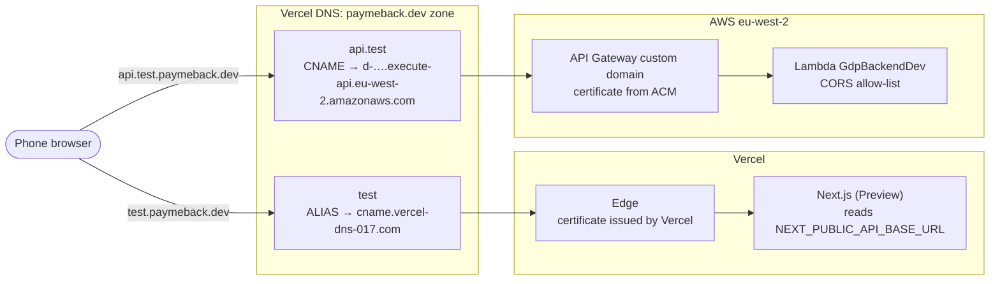
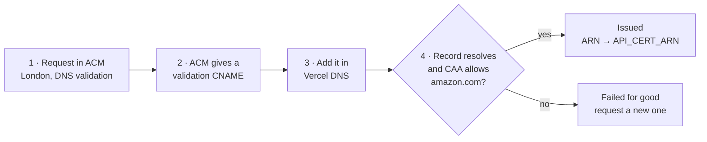
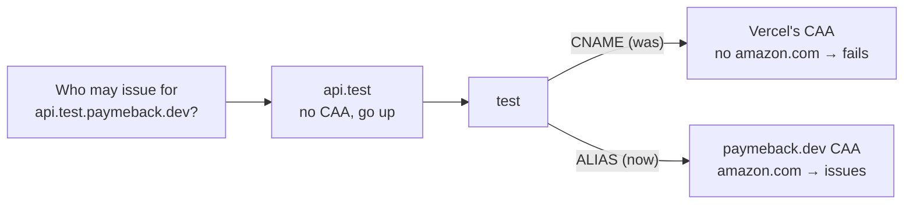
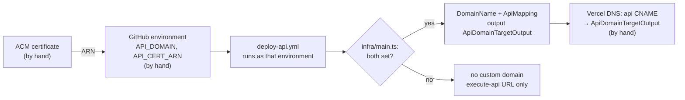

# Domains and certificates

How `paymeback.dev` names reach Vercel and AWS, how the API's certificate is issued, and why two of its settings are GitHub variables. The steps to set an environment up are in [deploy.md, *Domains*](../deploy.md#domains); this page is the picture behind them.

The same diagrams, laid out as boards: [Domains & certificates map](https://claude.ai/artifact/4wqQZFykwj8it1GN2wAXwD).

## How a request finds its server

Dev shown. Prod is the same without `test`: `paymeback.dev` → Vercel Production, `api.paymeback.dev` → `GdpBackendProd`.

- **Two certificates, two issuers.** HTTPS ends where the server is. Vercel makes and renews the site's certificate. The API ends at API Gateway, so it needs an ACM certificate in the API's region (London).
- **All DNS is at Vercel.** The domain uses Vercel's nameservers, so AWS can't add records itself. That's why the certificate and the `api.test` record are manual.
- **CORS.** The Lambda and the bills bucket only answer the origins in `apps/api/src/config/allowedOrigins.ts`.

## Getting the API certificate

- **Region.** API Gateway in eu-west-2 only uses eu-west-2 certificates.
- **CAA.** A CA looks for CAA records on the name, then on each parent until it finds some. `paymeback.dev` has `0 issue "amazon.com"` alongside Vercel's. Any subdomain on the way up must not be a CNAME: a CNAME is followed, and the CA reads the target's CAA instead (Vercel's, which doesn't list Amazon). That's why `test` is an ALIAS, not a CNAME.

## Why `API_DOMAIN` and `API_CERT_ARN` are GitHub variables

- **They feed the deploy, not the running app.** CDK reads them to decide whether to build a custom domain.
- **CDK can't make the certificate.** It can only create and validate one when the zone is in Route 53. The zone is at Vercel, so the certificate is made by hand and its ARN passed in.
- **One set per environment.** The code is the same for dev and prod; each GitHub environment holds its own values, and the deploy job gets them by running as that environment.
- **Variables, not secrets.** A hostname and an ARN aren't sensitive. Secrets live in Secrets Manager and the Lambda reads them at cold start.
- **Safe when blank.** With either unset the deploy skips the custom domain, so an environment deploys before its certificate exists.

## Where config lives

| Home | Read | By | Examples |
| --- | --- | --- | --- |
| GitHub environment variables | At deploy | CDK, via `deploy-api.yml` | `API_DOMAIN`, `API_CERT_ARN`, `AWS_DEPLOY_ROLE_ARN`, `AWS_REGION`, `APP_BASE_URL`, `STRIPE_ENABLED` |
| AWS Secrets Manager and SSM | At cold start | The Lambda | `gdp-<env>/stripe-secret-key`, `gdp-<env>/session-jwt-secret` |
| Vercel environment variables | At build | Next.js, baked into public JavaScript | `NEXT_PUBLIC_API_BASE_URL`, `NEXT_PUBLIC_APP_ENV` |
| Vercel DNS | On every lookup | Browsers and certificate authorities | `test` ALIAS, `api.test` CNAME, ACM validation CNAME, CAA |
